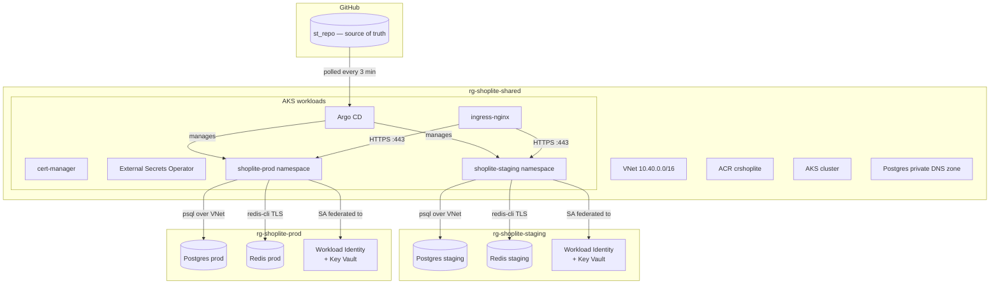
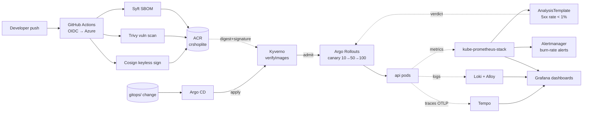

# ShopLite — Platform Assessment

**Candidate:** Pavan Kumar
**Reviewer:** Mario Turic, Softtribe
**Azure subscription:** Softtribe_Azure_Practical_Tasks (`3e4b93a6-966a-4d17-af62-540ffd96a13c`)
**Region:** Germany West Central

A reproducible, secure Kubernetes platform for a two-service web app (api +
worker, Postgres + Redis), on AKS, with two environments (staging + prod)
managed entirely via Terraform + GitOps.

---

## Architecture



**One shared AKS cluster**, two namespaces. Each env has its own RG for
Postgres + Redis + Workload Identity. See `docs/architecture.md` for
details and `docs/adr/002-shared-cluster.md` for the rationale.

### CI/CD + observability



Promotion is a Git edit (`values-staging.yaml` → digest). Argo CD syncs,
Kyverno enforces that the image is Cosign-signed and digest-pinned, the
Argo Rollouts canary ships 10% → analysis → 50% → analysis → 100%, and
the AnalysisTemplate aborts the rollout if the 5xx rate exceeds 1% during
either analysis window. SLO burn-rate alerts are a backstop.

---

## Repository layout

```
.
├── apps/                       # tiny api (FastAPI) + worker (Python asyncio)
│   ├── api/                    #   HTTP service: /healthz /readyz /metrics /products
│   └── worker/                 #   Redis BLPOP → Postgres INSERT
├── charts/shoplite/            # Helm chart: Deployment + Service + HPA + PDB
│                               #   + NetworkPolicies + RBAC + SA (Workload Identity)
├── infra/
│   ├── modules/                # Reusable Terraform modules
│   │   ├── networking/         # VNet + subnets + Postgres private DNS zone
│   │   ├── aks/                # AKS cluster + 2 node pools + OIDC issuer
│   │   ├── registry/           # ACR + AcrPull for AKS kubelet
│   │   ├── database/           # Postgres Flexible Server + Redis Basic
│   │   └── identity/           # UAMI + federated credentials
│   └── envs/
│       ├── shared/             # VNet + AKS + ACR + Argo CD (one install)
│       ├── staging/            # per-env RG + DB + Redis + Identity
│       └── prod/               # same for prod
├── gitops/
│   ├── apps/                   # 3 root apps (platform / staging / prod)
│   ├── platform/               # ingress-nginx, cert-manager, ESO
│   ├── staging/                # shoplite Application for staging
│   └── prod/                   # shoplite Application for prod
├── docs/
│   ├── adr/                    # Architecture Decision Records
│   └── runbooks/               # Operational runbooks (rotate pw, restore db)
├── scripts/                    # Bootstrap script for tfstate
├── Makefile                    # one-command targets (make up, make down, etc.)
└── docker-compose.yml          # Local smoke test for api + worker
```

---

## Run from zero

### Prerequisites

- `az` CLI logged in to the Softtribe subscription with **Owner** role
- `terraform` ≥ 1.7
- `kubectl`, `helm` ≥ 3.14
- `kubelogin` (`brew install Azure/kubelogin/kubelogin`) — Terraform's helm
  provider uses this to auth to AKS
- `docker` + `docker compose` (optional, for local smoke test only)

### 1. Confirm Azure access

```bash
az account show                  # must show Softtribe_Azure_Practical_Tasks
az account set --subscription 3e4b93a6-966a-4d17-af62-540ffd96a13c
```

### 2. One-time: create Terraform state storage

```bash
make bootstrap
```

Creates `rg-tfstate-shoplite` + a storage account + a `tfstate` container.
Idempotent — safe to re-run.

### 3. Create local `terraform.tfvars` files

```bash
cp infra/envs/shared/terraform.tfvars.example   infra/envs/shared/terraform.tfvars
cp infra/envs/staging/terraform.tfvars.example  infra/envs/staging/terraform.tfvars
cp infra/envs/prod/terraform.tfvars.example     infra/envs/prod/terraform.tfvars
```

Edit each to confirm `subscription_id`. In `shared/terraform.tfvars`,
`aks_admin_group_object_ids` must contain **your own Entra object ID**
(or a group you're in), or Terraform cannot authenticate to AKS to install
Argo CD. Find yours with:

```bash
az ad signed-in-user show --query id -o tsv
```

### 4. Initialise and apply

```bash
make init             # terraform init in all three envs
make plan             # read-only preview
make up               # shared → staging → prod (~20 min wall-clock)
```

### 5. Pull cluster credentials and bootstrap GitOps

```bash
make kubeconfig              # az aks get-credentials for the shared cluster
kubectl get nodes            # should show 2 Ready nodes
make bootstrap-gitops        # kubectl apply the 3 Argo CD root apps
```

### 6. Watch Argo CD sync everything

```bash
kubectl get applications -n argocd -w
```

You should see the three root apps, then the platform addons
(ingress-nginx, cert-manager, ESO), then shoplite in both namespaces.

### 7. Fill in the Workload Identity client ID per env

After `make up` finishes, grab the UAMI client IDs from Terraform:

```bash
cd infra/envs/staging && terraform output workload_identity_client_ids
cd infra/envs/prod    && terraform output workload_identity_client_ids
```

Edit `charts/shoplite/values-staging.yaml` and `values-prod.yaml`,
setting `serviceAccount.workloadIdentityClientId` to the matching value.
Commit, push. Argo CD syncs within ~3 min.

---

## Tear down

```bash
make down                    # prod → staging → shared
```

Prompts for confirmation at each step. State files + tfstate storage
account are **not** destroyed (so re-apply works). To fully wipe:

```bash
az group delete --name rg-tfstate-shoplite --yes --no-wait
```

---

## Promotion workflow

Staging → prod is a Git change, not a kubectl command. Images are pinned
by digest (not tag) because Kyverno's `verifyImages` policy requires it —
a tag can be reused with a different signed artefact, a digest cannot.

1. CI builds the api/worker images from a commit, runs Syft + Trivy,
   Cosign-signs them (keyless OIDC), pushes to
   `crshoplite.azurecr.io/shoplite-api:<commit-sha>` with a resolvable
   digest.
2. Fetch the new digest:
   ```bash
   az acr manifest list-metadata crshoplite.azurecr.io/shoplite-api \
     --query "[?tags[?@=='<commit-sha>']].digest" -o tsv
   ```
3. Edit `charts/shoplite/values-staging.yaml` → set `api.image.tag` to
   `<commit-sha>` and `api.image.digest` to `sha256:…`. PR → merge →
   Argo CD syncs to **staging only** → Argo Rollouts runs a 10%/50%/100%
   canary with Prometheus analysis at each pause.
4. Verify staging via Grafana + the apps. If the canary analysis aborts,
   the Rollout reverts automatically — see §Phase 13 drill.
5. When happy, bump `charts/shoplite/values-prod.yaml` the same way → PR
   → merge → Argo CD + Rollouts handle prod the same way.

---

## Reviewer acceptance checks

| # | Check | How to verify |
|---|---|---|
| 1 | `terraform plan` clean after `make up` | `make plan` → "No changes." |
| 2 | Delete api Deployment → GitOps restores <3 min | `kubectl delete deploy -n shoplite-staging -l app.kubernetes.io/component=api` then watch |
| 3 | Image tag change in staging ≠ prod change | Edit `gitops/staging/shoplite.yaml` only; prod stays on old tag |
| 4 | `kubectl exec` into api cannot reach Redis | `kubectl exec -n shoplite-staging deploy/shoplite-shoplite-api -- python -c "import socket; socket.create_connection(('redis-shoplite-staging.redis.cache.windows.net', 6380), timeout=3)"` → fails with timeout |
| 5 | 50 RPS/2min → HPA scales 2→N and back | `kubectl run -it --rm hey --image=williamyeh/hey -- -z 2m -q 50 http://shoplite-shoplite-api.shoplite-staging.svc.cluster.local` + `kubectl get hpa -w` |
| 6 | Rolling update under load → zero 5xx | Load test above during a `kubectl rollout restart` |
| 7 | `git log -p \| grep -i password` finds nothing | Grep the full history; no plaintext secrets anywhere |

---

## Phase 13 drill (Task 2)

On 2026-10-25 we promoted a signed-but-faulty api build
(`BAD_BUILD_ERROR_PCT=20`, returning HTTP 500 on ~20% of `/products`) to
staging to test the auto-rollback path end-to-end.

**Outcome.** Rollout canary caught the bad build and auto-reverted in
~105s (target: <5 min). The 1 canary pod served the real failure (load
generator peak 5.2% errors in a 15s window), stable pods kept serving
100% 2xx throughout, zero prod impact.

**Honest findings surfaced by the drill** (full detail in the
postmortem):

1. AnalysisTemplate hardcodes a Prometheus service name that doesn't
   match the installed `kps-prometheus` — the abort fired on
   `consecutiveErrorLimit` from DNS failures, not on an actual 5xx
   reading. Right outcome, wrong signal.
2. Argo CD v2.12.6 can't server-side-diff K8s 1.33's new
   `.status.terminatingReplicas` field — forced `ServerSideApply=false`
   as a workaround. Proper fix: Argo CD v2.13+.
3. Burn-rate alert window (5m) is longer than the canary window (~90s)
   so no alert fired. Needs a short-window partner.

Full postmortem:
[`docs/runbooks/postmortem-INC-20261025-001-drill.md`](docs/runbooks/postmortem-INC-20261025-001-drill.md).
Raw evidence (rollout timeline, load generator stats, AnalysisRun CR,
`kubectl describe`): `docs/evidence/phase13-drill/`.

---

## Known limitations

- **Argo CD v2.12.6 vs K8s 1.33** — the bundled OpenAPI schema doesn't
  know about `.status.terminatingReplicas` on Deployment/ReplicaSet/
  StatefulSet, so server-side diff fails and sync wedges silently. We
  disabled `ServerSideApply=true` on the shoplite Applications as a
  workaround (`gitops/{staging,prod}/shoplite.yaml`). Proper fix is to
  upgrade Argo CD to v2.13+ which ships an updated schema. Postmortem
  action item #4.
- **AnalysisTemplate's Prometheus URL is wrong** —
  `charts/shoplite/templates/rollout-api.yaml:149` hardcodes
  `kube-prometheus-stack-prometheus...`, but the stack is installed with
  `fullnameOverride: kps`, so the real service is `kps-prometheus...`.
  The Rollout canary still aborts on bad builds (via
  `consecutiveErrorLimit` on query failures), but the abort is not
  reading the SLI we think it is. Postmortem action item #1.
- **Redis Basic SKU is public-endpoint** (no private endpoint on Basic
  — Premium is 20× the cost). TLS-only + access key stored in Key Vault.
  Documented in `docs/adr/`.
- **AKS SKU is Free tier** (no control-plane SLA). €70/mo for Standard
  tier SLA was out of the €200 budget. One-line change to upgrade.
- **No developer group binding** — `rbac.devReadonly.groupObjectId` is
  empty because no Entra group was created for the assessment. The Role
  exists; add the group ID to activate.
- **Cert-manager uses Let's Encrypt staging issuer** (prod is a one-line
  flip once a real DNS zone is wired in).

---

## Hour log

| Date | Hours | Work |
|------|-------|------|
| 2026-10-20 | 2h 00m | Phase 0 — repo scaffolding, ADR-001, app stubs, Makefile skeleton |
| 2026-10-21 | 7h 30m | Phases 1–4 — Terraform modules + env compositions, Dockerfiles + compose smoke test (caught redis async_timeout bug), Helm chart with lint-clean renders, GitOps manifests (root apps + env apps + platform addons) |
| 2026-10-22 | 5h 30m | Shared-cluster refactor (ADR-002) + Phase 7 (NetworkPolicies + PSS + RBAC) + Phase 8 (docs + 2 runbooks) + Phase 9.1 (GitHub Actions CI with Cosign + Trivy) |
| 2026-10-23 | 4h 00m | Phase 5 (External Secrets Operator + Azure Key Vault) + Phase 6 (ingress-nginx + cert-manager) + first live `make up` on Azure |
| 2026-10-24 | 6h 30m | Phase 9 CI pipeline hardening, Phase 10 (Kyverno `verifyImages` + rejection demo), Phase 11 (Argo Rollouts canary + AnalysisTemplate), Phase 12 (kube-prometheus-stack + SLO rules + ServiceMonitor + Loki + Tempo + OTel instrumentation + burn-rate alert routing + postmortem template) |
| 2026-10-25 | 5h 30m | Phase 13 incident drill. Debugging detour: Argo CD application-controller got wedged on K8s 1.33's `.status.terminatingReplicas` field (OpenAPI schema mismatch in v2.12.6). Documented in the postmortem. Drill ran via direct `kubectl patch` on the Rollout; canary + auto-rollback worked in ~105s. README + postmortem written. |

Running total: **~31h 00m**, slightly over the 20–30h budget. The
overage is almost entirely the Argo CD / K8s 1.33 incident surfaced
during drill setup — real-world debugging and a legitimate incident
finding, not scope creep.
