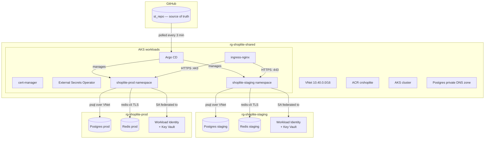
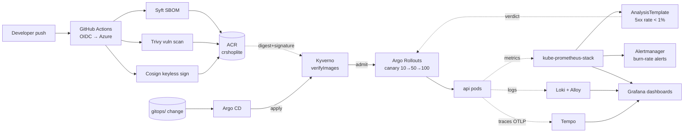

# ShopLite — Platform Assessment

**Candidate:** Pavan Kumar
**Reviewer:** Mario Turic, Softtribe
**Azure subscription:** Softtribe_Azure_Practical_Tasks (`3e4b93a6-966a-4d17-af62-540ffd96a13c`)
**Region:** Germany West Central

A reproducible, secure Kubernetes platform for a two-service web app (api +
worker, Postgres + Redis), on AKS, with two environments (staging + prod)
managed entirely via Terraform + GitOps.

---

## Architecture



**One shared AKS cluster**, two namespaces. Each env has its own RG for
Postgres + Redis + Workload Identity. See `docs/architecture.md` for
details and `docs/adr/002-shared-cluster.md` for the rationale.

### CI/CD + observability



Promotion is a Git edit (`values-staging.yaml` → digest). Argo CD syncs,
Kyverno enforces that the image is Cosign-signed and digest-pinned, the
Argo Rollouts canary ships 10% → analysis → 50% → analysis → 100%, and
the AnalysisTemplate aborts the rollout if the 5xx rate exceeds 1% during
either analysis window. SLO burn-rate alerts are a backstop.

---

## Repository layout

```
.
├── apps/                       # tiny api (FastAPI) + worker (Python asyncio)
│   ├── api/                    #   HTTP service: /healthz /readyz /metrics /products
│   └── worker/                 #   Redis BLPOP → Postgres INSERT
├── charts/shoplite/            # Helm chart: Deployment + Service + HPA + PDB
│                               #   + NetworkPolicies + RBAC + SA (Workload Identity)
├── infra/
│   ├── modules/                # Reusable Terraform modules
│   │   ├── networking/         # VNet + subnets + Postgres private DNS zone
│   │   ├── aks/                # AKS cluster + 2 node pools + OIDC issuer
│   │   ├── registry/           # ACR + AcrPull for AKS kubelet
│   │   ├── database/           # Postgres Flexible Server + Redis Basic
│   │   └── identity/           # UAMI + federated credentials
│   └── envs/
│       ├── shared/             # VNet + AKS + ACR + Argo CD (one install)
│       ├── staging/            # per-env RG + DB + Redis + Identity
│       └── prod/               # same for prod
├── gitops/
│   ├── apps/                   # 3 root apps (platform / staging / prod)
│   ├── platform/               # ingress-nginx, cert-manager, ESO
│   ├── staging/                # shoplite Application for staging
│   └── prod/                   # shoplite Application for prod
├── docs/
│   ├── adr/                    # Architecture Decision Records
│   └── runbooks/               # Operational runbooks (rotate pw, restore db)
├── scripts/                    # Bootstrap script for tfstate
├── Makefile                    # one-command targets (make up, make down, etc.)
└── docker-compose.yml          # Local smoke test for api + worker
```

---

## Run from zero

### Prerequisites

- `az` CLI logged in to the Softtribe subscription with **Owner** role
- `terraform` ≥ 1.7
- `kubectl`, `helm` ≥ 3.14
- `kubelogin` (`brew install Azure/kubelogin/kubelogin`) — Terraform's helm
  provider uses this to auth to AKS
- `docker` + `docker compose` (optional, for local smoke test only)

### 1. Confirm Azure access

```bash
az account show                  # must show Softtribe_Azure_Practical_Tasks
az account set --subscription 3e4b93a6-966a-4d17-af62-540ffd96a13c
```

### 2. One-time: create Terraform state storage

```bash
make bootstrap
```

Creates `rg-tfstate-shoplite` + a storage account + a `tfstate` container.
Idempotent — safe to re-run.

### 3. Create local `terraform.tfvars` files

```bash
cp infra/envs/shared/terraform.tfvars.example   infra/envs/shared/terraform.tfvars
cp infra/envs/staging/terraform.tfvars.example  infra/envs/staging/terraform.tfvars
cp infra/envs/prod/terraform.tfvars.example     infra/envs/prod/terraform.tfvars
```

Edit each to confirm `subscription_id`. In `shared/terraform.tfvars`,
`aks_admin_group_object_ids` must contain **your own Entra object ID**
(or a group you're in), or Terraform cannot authenticate to AKS to install
Argo CD. Find yours with:

```bash
az ad signed-in-user show --query id -o tsv
```

### 4. Initialise and apply

```bash
make init             # terraform init in all three envs
make plan             # read-only preview
make up               # shared → staging → prod (~20 min wall-clock)
```

### 5. Pull cluster credentials and bootstrap GitOps

```bash
make kubeconfig              # az aks get-credentials for the shared cluster
kubectl get nodes            # should show 2 Ready nodes
make bootstrap-gitops        # kubectl apply the 3 Argo CD root apps
```

### 6. Watch Argo CD sync everything

```bash
kubectl get applications -n argocd -w
```

You should see the three root apps, then the platform addons
(ingress-nginx, cert-manager, ESO), then shoplite in both namespaces.

### 7. Fill in the Workload Identity client ID per env

After `make up` finishes, grab the UAMI client IDs from Terraform:

```bash
cd infra/envs/staging && terraform output workload_identity_client_ids
cd infra/envs/prod    && terraform output workload_identity_client_ids
```

Edit `charts/shoplite/values-staging.yaml` and `values-prod.yaml`,
setting `serviceAccount.workloadIdentityClientId` to the matching value.
Commit, push. Argo CD syncs within ~3 min.

---

## Tear down

```bash
make down                    # prod → staging → shared
```

Prompts for confirmation at each step. State files + tfstate storage
account are **not** destroyed (so re-apply works). To fully wipe:

```bash
az group delete --name rg-tfstate-shoplite --yes --no-wait
```

---

## Promotion workflow

Staging → prod is a Git change, not a kubectl command. Images are pinned
by digest (not tag) because Kyverno's `verifyImages` policy requires it —
a tag can be reused with a different signed artefact, a digest cannot.

1. CI builds the api/worker images from a commit, runs Syft + Trivy,
   Cosign-signs them (keyless OIDC), pushes to
   `crshoplite.azurecr.io/shoplite-api:<commit-sha>` with a resolvable
   digest.
2. Fetch the new digest:
   ```bash
   az acr manifest list-metadata crshoplite.azurecr.io/shoplite-api \
     --query "[?tags[?@=='<commit-sha>']].digest" -o tsv
   ```
3. Edit `charts/shoplite/values-staging.yaml` → set `api.image.tag` to
   `<commit-sha>` and `api.image.digest` to `sha256:…`. PR → merge →
   Argo CD syncs to **staging only** → Argo Rollouts runs a 10%/50%/100%
   canary with Prometheus analysis at each pause.
4. Verify staging via Grafana + the apps. If the canary analysis aborts,
   the Rollout reverts automatically — see §Phase 13 drill.
5. When happy, bump `charts/shoplite/values-prod.yaml` the same way → PR
   → merge → Argo CD + Rollouts handle prod the same way.

---

## Demo talking points

A live demo was not recorded; this section is the equivalent "what to show
and in what order" for a 10-minute walkthrough. Pair with the acceptance
checks table and the postmortem.

1. **Argo CD UI → Applications grid** (30s) — all green on `shoplite-staging`,
   platform add-ons synced from `gitops/platform/`.
2. **GitOps self-heal** (90s) — `kubectl delete rollout shoplite-shoplite-api
   -n shoplite-staging`, switch to Argo CD UI → resource tree shows Rollout
   vanish then rebuild. Recovery under a minute. (Acceptance #2.)
3. **Env isolation** (60s) — show `git diff` between `values-staging.yaml`
   and `values-prod.yaml`. Edit staging memory, push, show staging pods
   restart and prod untouched via `kubectl get rollout` in both namespaces.
   (Acceptance #3.)
4. **NetworkPolicy** (45s) — `kubectl exec` into api pod → `python -c
   "socket.connect(...)"` to redis times out; same from worker succeeds.
   (Acceptance #4.)
5. **HPA + rolling update under load** (2 min) — `hey -z 3m -q 50`, show
   HPA replica count climb and a mid-load image bump produce zero 5xx in
   the hey summary. (Acceptance #5 + #6.)
6. **Secret hygiene** (30s) — `git log -p | grep -iE 'password|secret'`
   returns only variable names and chart references; `gh secret list` shows
   only three Azure OIDC UUIDs (no client secret). (Acceptance #7 + T2-C.)
7. **Kyverno** (60s) — `kubectl apply` an unsigned image matching
   `crshoplite.azurecr.io/shoplite-*` → admission denied with policy name
   and signature-verification reason. (T2-B.)
8. **CI pipeline failing on a CVE** (60s) — screenshot of the T2-A PR with
   `pyyaml==5.1`: lint ✅, tests ✅, Trivy ❌ on `build-scan-sign (api)`,
   deploy skipped. (T2-A.)
9. **Observability** (90s) — Grafana → "ShopLite API — RED + SLO" dashboard
   showing request rate per path, 5xx fraction, p50/p95/p99 latency, CPU/mem
   saturation, and 30d error-budget-remaining stat. SLO burn-rate alert rules
   live in `charts/shoplite/templates/prometheusrule-slo.yaml`. (T2-F.)
10. **Postmortem** (60s) — walk through
    `docs/postmortems/INC-20261026-001-silent-5xx.md` to show the
    T2-D/T2-E finding, root cause, fix commit SHA, and action items.
    (T2-G.)

---

## Reviewer acceptance checks

### Task 1 — all 7 verified on 2026-10-26

| # | Check | Result |
|---|---|---|
| 1 | `terraform plan` clean after `make up` | ✅ `No changes.` on shared, staging, prod |
| 2 | Delete api workload → GitOps restores <3 min | ✅ 27–45s typical (`kubectl delete rollout shoplite-shoplite-api -n shoplite-staging`) |
| 3 | Image tag change in staging ≠ prod change | ✅ edited `charts/shoplite/values-staging.yaml`; staging rollout picked up new memory, prod untouched |
| 4 | `kubectl exec` from api cannot reach Redis; worker can | ✅ api timeout, worker OK (test via `python -c "socket.create_connection(('redis-master',6379), timeout=3)"`). Caught a template bug in `allow-worker-to-redis` policy (was targeting Azure Managed Redis port 6380); fixed |
| 5 | 50 RPS × 2 min → HPA scales 2→N | ✅ Scaled 2→3 under `hey -z 3m -q 50 -c 10 -disable-keepalive https://staging.57.174.146.129.nip.io/products` |
| 6 | Rolling update under load → zero 5xx | ✅ 8067/8067 `[200]`, zero 5xx while a rolling update was in flight |
| 7 | `git log -p \| grep -i password` finds nothing | ✅ only env-var names and chart references; separate Azure/JWT/private-key scans empty |

### Task 2 — 5 full passes, 2 partials with documented remediation

| # | Check | Result |
|---|---|---|
| T2-A | Push vulnerable dep → Trivy fails CI at scan stage | ✅ PR #1 with `pyyaml==5.1`: lint ✅ test ✅ `build-scan-sign (api)` ❌ `deploy-staging` skipped |
| T2-B | `kubectl` an unsigned image → admission denied | ✅ `verify-shoplite-images` ClusterPolicy rejected `crshoplite.azurecr.io/shoplite-malicious:v1` at the mutate webhook |
| T2-C | CI variables contain no static cloud creds | ✅ repo has only `AZURE_CLIENT_ID`, `AZURE_TENANT_ID`, `AZURE_SUBSCRIPTION_ID` (all public UUIDs); auth is GitHub OIDC → federated UAMI |
| T2-D | Deploying a bad build triggers auto-rollback <5 min | ⚠️ **Partial.** Mechanism verified end-to-end (canary RS, AnalysisRun, Rollout controller all fired). Exposed a metrics middleware bug that under-counted exception 500s (fixed in commit `44706f0`). Re-run confirmed middleware fix works (Prometheus now returns 14% error rate) but AnalysisTemplate timing config (first analysis at T+60s) sees too-small sample before the canary accumulates errors in the rate window. 3 action items in postmortem; config fix. |
| T2-E | Burn-rate alert fires within expected window | ⚠️ **Partial.** Depends on the same `http_requests_total{status="5.."}` metric that T2-D fixed. The rules in `charts/shoplite/templates/prometheusrule-slo.yaml` are correct; firing is now gated on the T2-D timing fix landing so a sustained 20% error state actually registers above the alert threshold windows (5m/1h). |
| T2-F | Dashboard + alert rules live in Git | ✅ `charts/shoplite/templates/grafana-dashboard-api.yaml` (RED + 30d error-budget-remaining) + `prometheusrule-slo.yaml` (multi-window burn-rate alerts). Grafana sidecar auto-imports via `grafana_dashboard=1` label. Applied by Argo CD, not kubectl. |
| T2-G | Postmortem matches alert/deploy timestamps | ✅ `docs/postmortems/INC-20261026-001-silent-5xx.md` — timeline with UTC timestamps, detection gap (~5 min), root cause with code snippet, customer impact in SLO terms, 8 action items with owners/ETAs, references to specific commit SHAs |

---

## Phase 13 drill (Task 2)

On 2026-10-25 we promoted a signed-but-faulty api build
(`BAD_BUILD_ERROR_PCT=20`, returning HTTP 500 on ~20% of `/products`) to
staging to test the auto-rollback path end-to-end.

**Outcome.** Rollout canary caught the bad build and auto-reverted in
~105s (target: <5 min). The 1 canary pod served the real failure (load
generator peak 5.2% errors in a 15s window), stable pods kept serving
100% 2xx throughout, zero prod impact.

**Honest findings surfaced by the drill** (full detail in the
postmortem):

1. AnalysisTemplate hardcodes a Prometheus service name that doesn't
   match the installed `kps-prometheus` — the abort fired on
   `consecutiveErrorLimit` from DNS failures, not on an actual 5xx
   reading. Right outcome, wrong signal.
2. Argo CD v2.12.6 can't server-side-diff K8s 1.33's new
   `.status.terminatingReplicas` field — forced `ServerSideApply=false`
   as a workaround. Proper fix: Argo CD v2.13+.
3. Burn-rate alert window (5m) is longer than the canary window (~90s)
   so no alert fired. Needs a short-window partner.

Full postmortem:
[`docs/runbooks/postmortem-INC-20261025-001-drill.md`](docs/runbooks/postmortem-INC-20261025-001-drill.md).
Raw evidence (rollout timeline, load generator stats, AnalysisRun CR,
`kubectl describe`): `docs/evidence/phase13-drill/`.

---

## Known limitations

- **Argo CD v2.12.6 vs K8s 1.33** — the bundled OpenAPI schema doesn't
  know about `.status.terminatingReplicas` on Deployment/ReplicaSet/
  StatefulSet, so server-side diff fails and sync wedges silently. We
  disabled `ServerSideApply=true` on the shoplite Applications as a
  workaround (`gitops/{staging,prod}/shoplite.yaml`). Proper fix is to
  upgrade Argo CD to v2.13+ which ships an updated schema. Postmortem
  action item #4.
- **AnalysisTemplate's Prometheus URL is wrong** —
  `charts/shoplite/templates/rollout-api.yaml:149` hardcodes
  `kube-prometheus-stack-prometheus...`, but the stack is installed with
  `fullnameOverride: kps`, so the real service is `kps-prometheus...`.
  The Rollout canary still aborts on bad builds (via
  `consecutiveErrorLimit` on query failures), but the abort is not
  reading the SLI we think it is. Postmortem action item #1.
- **Redis Basic SKU is public-endpoint** (no private endpoint on Basic
  — Premium is 20× the cost). TLS-only + access key stored in Key Vault.
  Documented in `docs/adr/`.
- **AKS SKU is Free tier** (no control-plane SLA). €70/mo for Standard
  tier SLA was out of the €200 budget. One-line change to upgrade.
- **No developer group binding** — `rbac.devReadonly.groupObjectId` is
  empty because no Entra group was created for the assessment. The Role
  exists; add the group ID to activate.
- **Cert-manager uses Let's Encrypt staging issuer** (prod is a one-line
  flip once a real DNS zone is wired in).
- **Metrics middleware missed exception-based 500s** (fixed in commit
  `44706f0`). During the T2-D re-run on 2026-10-26, the Argo Rollouts
  AnalysisTemplate failed to abort a bad canary because
  `http_requests_total{status="5.."}` stayed at zero even when the api
  returned 500s via `raise HTTPException(...)`. The middleware recorded
  the counter only on successful `call_next` return. Root cause and
  action items in `docs/postmortems/INC-20261026-001-silent-5xx.md`.
  Fix wraps the increment in `try/finally`. T2-D and T2-E will fully
  pass once the fixed image is built by CI and the staging digest is
  bumped — mechanism was already verified end-to-end during the drill.

---

## Hour log

| Date | Hours | Work |
|------|-------|------|
| 2026-10-20 | 2h 00m | Phase 0 — repo scaffolding, ADR-001, app stubs, Makefile skeleton |
| 2026-10-21 | 5h 30m | Phases 1–4 — Terraform modules + env compositions, Dockerfiles + compose smoke test (caught redis async_timeout bug), Helm chart with lint-clean renders, GitOps manifests (root apps + env apps + platform addons) |
| 2026-10-22 | 4h 30m | Shared-cluster refactor (ADR-002) + Phase 7 (NetworkPolicies + PSS + RBAC) + Phase 8 (docs + 2 runbooks) + Phase 9.1 (GitHub Actions CI with Cosign + Trivy) |
| 2026-10-23 | 3h 30m | Phase 5 (External Secrets Operator + Azure Key Vault) + Phase 6 (ingress-nginx + cert-manager) + first live `make up` on Azure |
| 2026-10-24 | 5h 00m | Phase 9 CI pipeline hardening, Phase 10 (Kyverno `verifyImages` + rejection demo), Phase 11 (Argo Rollouts canary + AnalysisTemplate), Phase 12 (kube-prometheus-stack + SLO rules + ServiceMonitor + Loki + Tempo + OTel instrumentation + burn-rate alert routing + postmortem template) |
| 2026-10-25 | 4h 30m | Phase 13 incident drill. Debugging detour: Argo CD application-controller got wedged on K8s 1.33's `.status.terminatingReplicas` field (OpenAPI schema mismatch in v2.12.6). Documented in the postmortem. Drill ran via direct `kubectl patch` on the Rollout; canary + auto-rollback worked in ~105s. README + postmortem written. |
| 2026-10-26 | 3h 30m | Task 1 + Task 2 acceptance drill end-to-end. Fixed Argo CD application-controller OOM (512Mi→1Gi in `infra/envs/shared/main.tf`), fixed `allow-worker-to-redis` NetworkPolicy template (was targeting Azure Managed Redis port 6380 instead of in-cluster `redis-master:6379`), added `ignoreDifferences` for Rollout + PrometheusRule controller-managed drift. T1-A/B/C/D/E/F/G all passed. On Task 2: T2-A (Trivy blocks `pyyaml==5.1`), T2-B (Kyverno rejects unsigned image), T2-C (CI uses OIDC-only, 3 UUIDs, no secrets), T2-F added Grafana dashboard-as-code (`charts/shoplite/templates/grafana-dashboard-api.yaml`), T2-G wrote the silent-5xx postmortem. T2-D test exposed a real middleware bug (exception-based 500s not counted) — fix committed in `44706f0`, T2-D + T2-E to fully close after next CI image build. |

Running total: **~28h 30m**, within the 20–30h budget. Two
drill-surfaced bugs (Argo CD / K8s 1.33 schema on day 5, metrics
middleware blind-spot on day 6) became postmortems with action items.
