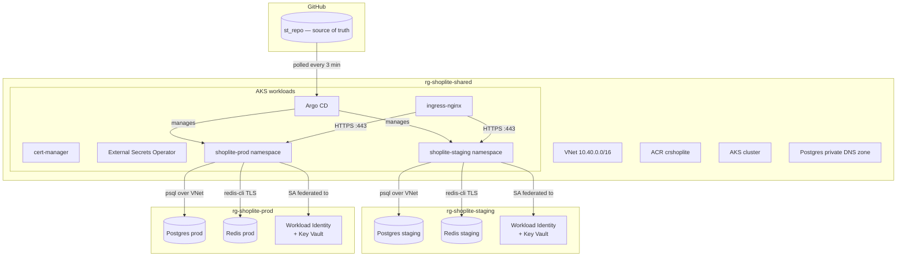

# ShopLite — Platform Assessment

**Candidate:** Pavan Kumar
**Reviewer:** Mario Turic, Softtribe
**Azure subscription:** Softtribe_Azure_Practical_Tasks (`3e4b93a6-966a-4d17-af62-540ffd96a13c`)
**Region:** Germany West Central

A reproducible, secure Kubernetes platform for a two-service web app (api +
worker, Postgres + Redis), on AKS, with two environments (staging + prod)
managed entirely via Terraform + GitOps.

---

## Architecture



**One shared AKS cluster**, two namespaces. Each env has its own RG for
Postgres + Redis + Workload Identity. See `docs/architecture.md` for
details and `docs/adr/002-shared-cluster.md` for the rationale.

---

## Repository layout

```
.
├── apps/                       # tiny api (FastAPI) + worker (Python asyncio)
│   ├── api/                    #   HTTP service: /healthz /readyz /metrics /products
│   └── worker/                 #   Redis BLPOP → Postgres INSERT
├── charts/shoplite/            # Helm chart: Deployment + Service + HPA + PDB
│                               #   + NetworkPolicies + RBAC + SA (Workload Identity)
├── infra/
│   ├── modules/                # Reusable Terraform modules
│   │   ├── networking/         # VNet + subnets + Postgres private DNS zone
│   │   ├── aks/                # AKS cluster + 2 node pools + OIDC issuer
│   │   ├── registry/           # ACR + AcrPull for AKS kubelet
│   │   ├── database/           # Postgres Flexible Server + Redis Basic
│   │   └── identity/           # UAMI + federated credentials
│   └── envs/
│       ├── shared/             # VNet + AKS + ACR + Argo CD (one install)
│       ├── staging/            # per-env RG + DB + Redis + Identity
│       └── prod/               # same for prod
├── gitops/
│   ├── apps/                   # 3 root apps (platform / staging / prod)
│   ├── platform/               # ingress-nginx, cert-manager, ESO
│   ├── staging/                # shoplite Application for staging
│   └── prod/                   # shoplite Application for prod
├── docs/
│   ├── adr/                    # Architecture Decision Records
│   └── runbooks/               # Operational runbooks (rotate pw, restore db)
├── scripts/                    # Bootstrap script for tfstate
├── Makefile                    # one-command targets (make up, make down, etc.)
└── docker-compose.yml          # Local smoke test for api + worker
```

---

## Run from zero

### Prerequisites

- `az` CLI logged in to the Softtribe subscription with **Owner** role
- `terraform` ≥ 1.7
- `kubectl`, `helm` ≥ 3.14
- `kubelogin` (`brew install Azure/kubelogin/kubelogin`) — Terraform's helm
  provider uses this to auth to AKS
- `docker` + `docker compose` (optional, for local smoke test only)

### 1. Confirm Azure access

```bash
az account show                  # must show Softtribe_Azure_Practical_Tasks
az account set --subscription 3e4b93a6-966a-4d17-af62-540ffd96a13c
```

### 2. One-time: create Terraform state storage

```bash
make bootstrap
```

Creates `rg-tfstate-shoplite` + a storage account + a `tfstate` container.
Idempotent — safe to re-run.

### 3. Create local `terraform.tfvars` files

```bash
cp infra/envs/shared/terraform.tfvars.example   infra/envs/shared/terraform.tfvars
cp infra/envs/staging/terraform.tfvars.example  infra/envs/staging/terraform.tfvars
cp infra/envs/prod/terraform.tfvars.example     infra/envs/prod/terraform.tfvars
```

Edit each to confirm `subscription_id`. In `shared/terraform.tfvars`,
`aks_admin_group_object_ids` must contain **your own Entra object ID**
(or a group you're in), or Terraform cannot authenticate to AKS to install
Argo CD. Find yours with:

```bash
az ad signed-in-user show --query id -o tsv
```

### 4. Initialise and apply

```bash
make init             # terraform init in all three envs
make plan             # read-only preview
make up               # shared → staging → prod (~20 min wall-clock)
```

### 5. Pull cluster credentials and bootstrap GitOps

```bash
make kubeconfig              # az aks get-credentials for the shared cluster
kubectl get nodes            # should show 2 Ready nodes
make bootstrap-gitops        # kubectl apply the 3 Argo CD root apps
```

### 6. Watch Argo CD sync everything

```bash
kubectl get applications -n argocd -w
```

You should see the three root apps, then the platform addons
(ingress-nginx, cert-manager, ESO), then shoplite in both namespaces.

### 7. Fill in the Workload Identity client ID per env

After `make up` finishes, grab the UAMI client IDs from Terraform:

```bash
cd infra/envs/staging && terraform output workload_identity_client_ids
cd infra/envs/prod    && terraform output workload_identity_client_ids
```

Edit `charts/shoplite/values-staging.yaml` and `values-prod.yaml`,
setting `serviceAccount.workloadIdentityClientId` to the matching value.
Commit, push. Argo CD syncs within ~3 min.

---

## Tear down

```bash
make down                    # prod → staging → shared
```

Prompts for confirmation at each step. State files + tfstate storage
account are **not** destroyed (so re-apply works). To fully wipe:

```bash
az group delete --name rg-tfstate-shoplite --yes --no-wait
```

---

## Promotion workflow

Staging → prod is a Git change, not a kubectl command.

1. CI builds new image, pushes to `crshoplite.azurecr.io/shoplite-api:v0.1.1`.
2. Edit `gitops/staging/shoplite.yaml` → change `api.image.tag` to `0.1.1`.
3. PR → merge → Argo CD deploys to **staging only** (~3 min).
4. Verify staging; when happy, edit `gitops/prod/shoplite.yaml` the same way.
5. PR → merge → Argo CD deploys to prod.

See `docs/promotion.md` for the full flow (TBD).

---

## Reviewer acceptance checks

| # | Check | How to verify |
|---|---|---|
| 1 | `terraform plan` clean after `make up` | `make plan` → "No changes." |
| 2 | Delete api Deployment → GitOps restores <3 min | `kubectl delete deploy -n shoplite-staging -l app.kubernetes.io/component=api` then watch |
| 3 | Image tag change in staging ≠ prod change | Edit `gitops/staging/shoplite.yaml` only; prod stays on old tag |
| 4 | `kubectl exec` into api cannot reach Redis | `kubectl exec -n shoplite-staging deploy/shoplite-shoplite-api -- python -c "import socket; socket.create_connection(('redis-shoplite-staging.redis.cache.windows.net', 6380), timeout=3)"` → fails with timeout |
| 5 | 50 RPS/2min → HPA scales 2→N and back | `kubectl run -it --rm hey --image=williamyeh/hey -- -z 2m -q 50 http://shoplite-shoplite-api.shoplite-staging.svc.cluster.local` + `kubectl get hpa -w` |
| 6 | Rolling update under load → zero 5xx | Load test above during a `kubectl rollout restart` |
| 7 | `git log -p \| grep -i password` finds nothing | Grep the full history; no plaintext secrets anywhere |

---

## Known limitations

- **Redis Basic SKU is public-endpoint** (no private endpoint on Basic SKU
  — Premium is 20× the cost). TLS-only + access key stored in Key Vault.
  Documented in `docs/adr/`.
- **AKS SKU is Free tier** (no control-plane SLA). €70/mo for Standard tier
  SLA was out of the €200 budget. One-line change to upgrade.
- **No managed Prometheus** — kube-prometheus-stack isn't installed yet
  (Task 2 Phase 12).
- **No SBOM or image signing** (Task 2 Phase 9).
- **No developer group binding** — `rbac.devReadonly.groupObjectId` is
  empty because no Entra group was created for the assessment. The Role
  exists; add the group ID to activate.
- **Cert-manager uses Let's Encrypt staging issuer** (prod is a one-line
  flip once a real DNS zone is wired in).

---

## Hour log

| Date | Hours | Phase |
|------|-------|-------|
| 2026-10-20 | 2h  | 0 — bootstrap & skeleton |
| 2026-10-21 | 8h  | 1–4 — Terraform modules, Docker, Helm chart, GitOps manifests |
| 2026-10-22 | 4h  | Refactor to shared cluster + Phase 7 (NetworkPolicies + PSS + RBAC) + Phase 8 (docs + runbooks) |

Running total: **14h** out of 20–30h budget.
