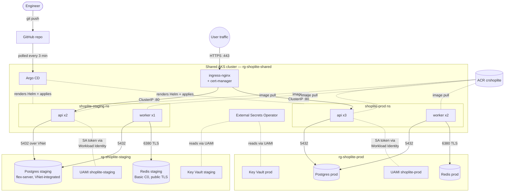

# Architecture

## Overview

ShopLite runs on a single AKS cluster in Germany West Central. Two
namespaces (`shoplite-staging`, `shoplite-prod`) share the cluster but
have their own data plane (Postgres, Redis, Workload Identity, future
Key Vault) in per-env resource groups.



## Why these choices

### One shared cluster
Matches spec. Per-env data planes still isolated via separate RGs +
delegated subnets. One Argo CD UI, one upgrade path. See
`docs/adr/002-shared-cluster.md`.

### Managed Postgres + Redis
In-cluster Postgres operators (CloudNativePG, Zalando) are powerful but
add operational surface for a trivial app. Flexible Server is managed,
has PITR, and uses VNet integration for private connectivity. Redis
Basic is cheapest; the private-endpoint-less tradeoff is documented.

### Workload Identity (no passwords in pods)
Each env has one UAMI federated to the `shoplite` ServiceAccount in its
namespace. The AKS Workload Identity webhook projects a short-lived SA
token into the pod; the Azure SDK exchanges it for an Entra token at
`login.microsoftonline.com`. No client secrets, no storage keys.

### GitOps (Argo CD app-of-apps)
Three root Applications (`root-platform`, `root-staging`, `root-prod`)
each watch one folder in Git. Everything else cascades automatically.
Promotion is a Git edit, not a kubectl command.

### Zero-trust networking
Namespace default-deny + explicit allow NetworkPolicies.
api can reach Postgres but not Redis (enforced).
worker can reach both.
Pod Security Standards: `restricted` enforced at namespace level.

## Networking details

| Range | Purpose |
|---|---|
| `10.40.0.0/16` | Shared VNet |
| `10.40.0.0/20` | AKS nodes + pod IPs (CNI Overlay below) |
| `10.40.17.0/24` | Services subnet (private endpoints, future ILBs) |
| `10.40.18.0/24` | Postgres staging (delegated to flexible server) |
| `10.40.19.0/24` | Postgres prod (delegated to flexible server) |
| `10.244.0.0/16` | Pod CIDR (overlay, invisible outside cluster) |
| `10.0.0.0/16` | Service CIDR (ClusterIPs, invisible outside cluster) |

Azure CNI Overlay — pods get IPs from the overlay, not from the VNet
subnet. Means we can scale pod replicas without exhausting the /20.

## Image flow

```
Dev commit → GitHub Actions (Task 2) → Trivy scan → Cosign sign → push to crshoplite.azurecr.io
                                                                              │
                                                                              ▼
                                                                          Argo CD
                                                                              │
                                                                              ▼
Helm render → NetworkPolicies + Deployment + Service + PDB + HPA → applied to namespace
                                                                              │
                                                                              ▼
                                                                           kubelet pulls image
                                                                      (AcrPull via kubelet UAMI)
```

## Secret flow (Phase 5 — not yet implemented)

```
Terraform (random_password) → stores in state → Key Vault secret (per env)
                                                        │
                                                        ▼
         ESO (via UAMI, Workload Identity) ──reads──→  Secret
                                                        │
                                                        ▼
                                        materialises  K8s Secret
                                                        │
                                                        ▼
                                     Pod envFrom.secretRef (api + worker)
```

Nothing ever lands in Git. State lives in the locked Azure storage
account, never on a laptop.
